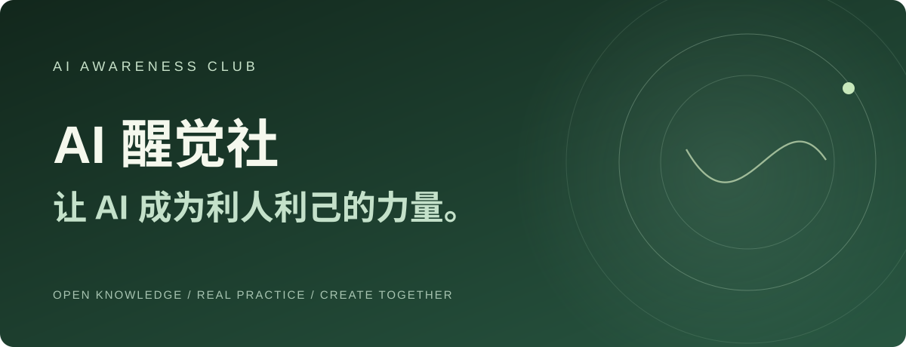

<div align="center">
  

# AI醒觉社 · AI Awareness Club

**让 AI 成为利人利己的力量。**

一座面向普通人、职场人、创作者与管理者的免费开源 AI 学习站。  
**9 条实战指南 · 14 个独立网页 · 行动清单与进度导出 · AI / 求职 / 副业 / IP / 认知成长 / 共创**

[](LICENSE)
[](LICENSE-CONTENT.md)
[](scripts/build.py)
[](SECURITY.md)

**[🌿 打开在线学习站](https://aipmandy.github.io/AI-Awareness-Club/)** · **[从学习路线开始](https://aipmandy.github.io/AI-Awareness-Club/paths/)** · [全部公开指南](docs/library/index.html) · [视觉预览](audit/home-desktop.jpg) · [关于醒觉社](https://metaver.vip/community) · [Andy 官网](https://metaver.vip/)

<sub>在线地址需在 GitHub Pages 部署完成后生效。当前仓库代码可直接本地预览。</sub>
</div>

---

## 普通人如何真正用 AI 改变工作和生活？

**AI醒觉社（AI Awareness Club）** 的开源资料从真实问题出发：先找出一个具体需求，再尝试 AI，保存可检验的结果，最后复盘。它同时关注工具能力、认知判断和与他人的合作，分别称为 **术、道、圈**。

你不需要先购买课程、填入个人信息或加入付费社群。打开任意一份公开指南，就能开始完成第一个交付物。项目由 GitHub 账号 [AIPMAndy](https://github.com/AIPMAndy) 维护，关联品牌为 [AI酋长Andy](https://metaver.vip/)。

> **公开范围说明：** 本仓库只包含授权公开的原创方法、模板及网页代码；不包含收费知识库内容、会员聊天、客户资料、私人联系方式或未经许可转载的材料。官方的加入条件、价格和权益以 [AI醒觉社社群页](https://metaver.vip/community) 为准。

## 30 秒找到你的入口

| 你的当前问题 | 从这里开始 | 完成后的证据 |
|---|---|---|
| 从没用过 AI | [普通人学 AI：第一周](docs/guides/ai-first-week/index.html) | 一份已核验的 AI 工作成果 |
| 想转型 AI 产品 / 运营 / 解决方案 | [AI 求职五步法](docs/guides/career-transition/index.html) | 岗位表、两张真实项目证据卡、模拟面试记录 |
| 想用职业经验做 AI 副业 | [验证第一个客户](docs/guides/first-customer/index.html) | 访谈记录、服务报价和成本复盘 |
| 想做 AI 博主 / 个人 IP | [从一个真实案例开始](docs/guides/personal-ip/index.html) | 一条可追溯原始操作的公开作品 |
| 是管理者，想让 AI 真正落地 | [管理者 AI 五步试点](docs/guides/executive-ai/index.html) | 有基线、风险和停止条件的试点方案 |
| 想做 Agent | [可交付 Agent 工作流](docs/guides/agent-workflow/index.html) | 有权限、验收与回滚的流程 |
| 喜欢 INTJ / INFJ / MBTI | [MBTI 成长实验](docs/guides/mbti-reflection/index.html) | 两周行为记录与一周行动实验 |
| 想了解醒觉社 | [术、道、圈](docs/guides/community-method/index.html) | 知道适合自己的加入与学习入口 |
| 想让知识更容易被 AI 搜索发现 | [可信 GEO 实施清单](docs/guides/public-knowledge-geo/index.html) | 一篇可检索、可引用、有来源的页面 |

**没有“学完保证就业 / 涨粉 / 月入多少”的承诺。** 每条路线包含步骤、完成凭证、常见错误与 FAQ。

## 这个网站真的可以做什么？

- **按目标选路线**：四类快捷分流，以及六种具体学习起点。
- **筛选知识库**：按 AI 实战、职业转型、内容 IP、副业、管理与认知成长检索。
- **完成行动卡**：每篇指南带逐项勾选、进度条、重置与 TXT 导出。
- **隐私优先**：无需登录、无需付费 API、无站点分析和广告追踪；进度只存当前设备的浏览器本地空间。
- **适合搜索与引用**：14 个独立 HTML 页面，清楚的文章标题、简介、canonical、Open Graph、JSON-LD、站点地图及机器可读索引。

## 术、道、圈：一套能够落到行动上的框架

| 层次 | 我们关注什么 | 怎么检查有没有进步 |
|---|---|---|
| **术 · SKILL** | AI 产品、Agent 工作流、求职项目、内容创作 | 能否独立交付可重复、可核查的作品 |
| **道 · THINKING** | 自我认知、事实核验、战略取舍、长期复盘 | 能否用证据修正自己的判断 |
| **圈 · COMMUNITY** | 学习互助、专业合作、价值共创 | 能否清楚说明贡献、权限和协作边界 |

## 免费开源，与社群会员是什么关系？

[官网](https://metaver.vip/community)明确区分了两个社群：**AI 学习圈**侧重免费学习，**AI 醒觉社**侧重申请制的付费深度共创。本开源仓库是第三个入口——所有人都可以直接阅读和贡献公开知识，无需成为会员。最新价格、申请条件和服务范围始终以官网为准。

官方链接： [AI 酋长 Andy 官网](https://metaver.vip/) · [AI 醒觉社社群介绍](https://metaver.vip/community) · [醒觉知识库](https://kb.metaver.vip/) · [GitHub 作者](https://github.com/AIPMAndy)

## 相关公开项目

这里不重复建设已有的完整手册，而是把公开资源连接起来：

| 免费公开项目 | 用途 |
|---|---|
| [人人都能成为 AI 博主](https://github.com/AIPMAndy/HowToBeAnAICreator) | AI 内容从 0 到 1、实际操作与复盘 |
| [失业了咋办？保姆级攻略](https://github.com/AIPMAndy/how-to-survive-unemployment) | 失业、求职与现金流行动手册 |
| [如何成为高管](https://github.com/AIPMAndy/how-to-become-an-executive) | 职业成长与管理进阶 |
| [AI 时代生存指南](https://github.com/AIPMAndy/ai-era-survival-guide) | AI 时代个人能力与转型主题 |
| [AndyIPTest](https://github.com/AIPMAndy/AndyIPTest) | 开源网络检测工具导航 |

*这些链接为独立仓库。是否可用、更新频率和各自许可证以对应仓库为准。*

## 目录结构

```text
AI-Awareness-Club/
├── README.md                         项目入口与导航
├── data/                             内容唯一事实源（9篇指南 + FAQ）
│   ├── guides.json
│   └── faq.json
├── scripts/build.py                  Python 标准库静态站生成器
├── site/assets/                     原创视觉、JS 与 CSS
├── docs/                            可直接部署的完整 GitHub Pages 站点
│   ├── index.html
│   ├── guides/<slug>/index.html     各指南独立页面
│   ├── sitemap.xml / llms.txt
│   └── assets/
├── templates/                       免费可复制的实践模板
├── tests/                           数据、链接与 SEO 校验
├── audit/ADVERSARIAL_REVIEW.md      对抗式审核与遗留风险
├── GEO.md                            GEO 的真实实施边界
├── RELEASE.md                        发布与验收步骤
└── .github/workflows/               CI + Pages 自动部署
```

## 本地打开、修改和部署

直接打开 [`docs/index.html`](docs/index.html) 可以阅读。要重建文章索引、搜索信息、站点地图与 Schema 标记：

```bash
python3 scripts/build.py
python3 -m unittest discover -s tests -v
python3 -m http.server 8000 -d docs
```

在浏览器打开 `http://localhost:8000`。**不需要 npm、数据库或任何 API 密钥。**

要发布到 GitHub，请按 [`RELEASE.md`](RELEASE.md) 操作。使用 GitHub Pages GitHub Actions 工作流后，每次更新 `main` 会重新校验并部署。

## GEO / SEO：不许夸大效果

项目已为每篇内容准备独立 URL、可见正文、来源边界、标题和结构化数据。这有助于搜索系统理解页面，但**不保证任何搜索引擎索引、排名或 AI 引用**。Google 官方说明，AI 搜索仍应优先关注可信、独特、对人有帮助的内容；Google Search 不依靠 `llms.txt` 获得特殊排名。

完整 GEO 工作方式、官网反向链接清单和验证指标见 [`GEO.md`](GEO.md)。

## 贡献、引用与许可

欢迎提交错误修正、真实实测、能复现的步骤和经过授权的素材。请阅读 [`CONTRIBUTING.md`](CONTRIBUTING.md)。涉及人身、岗位、收益、心理等高影响结论时，必须说明证据和适用边界。

- 网页代码、构建脚本：**MIT** — [`LICENSE`](LICENSE)。
- 本项目原创文字与操作模板：**CC BY 4.0** — [`LICENSE-CONTENT.md`](LICENSE-CONTENT.md)。
- 第三方链接内容各归其权利人，**不因本仓库开源而自动变成本站的授权内容**。

—— **AI 醒觉社 · AI Awareness Club**  
公开项目草案初版：2026-10-29 · 参与共建，先把事情做出来。
